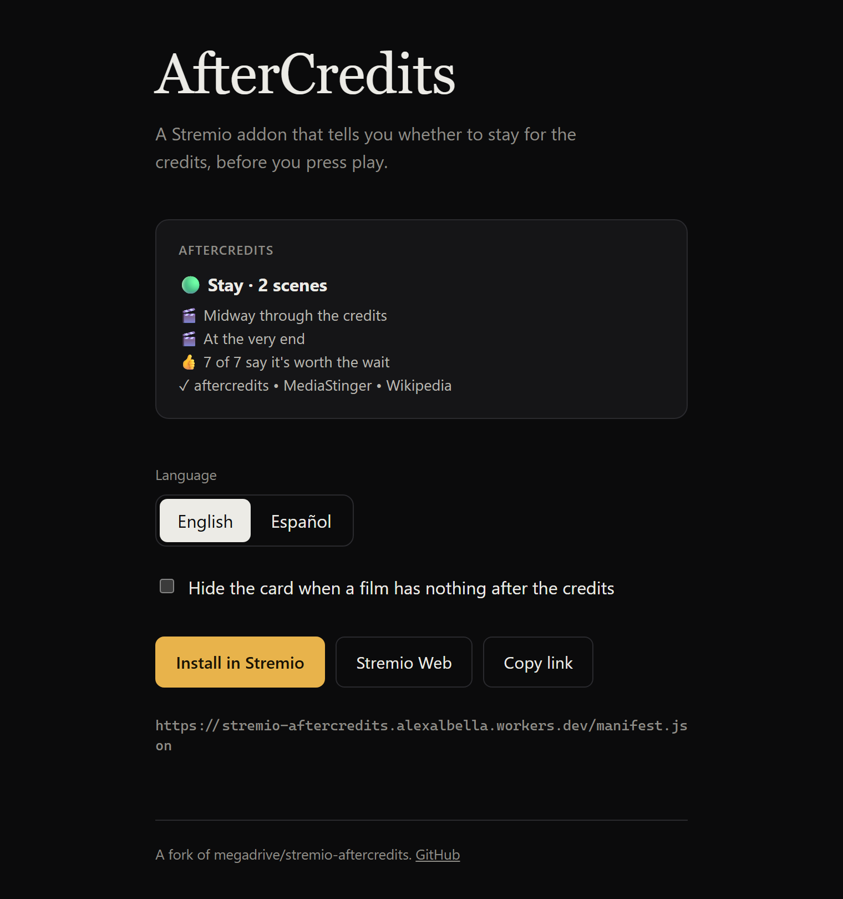
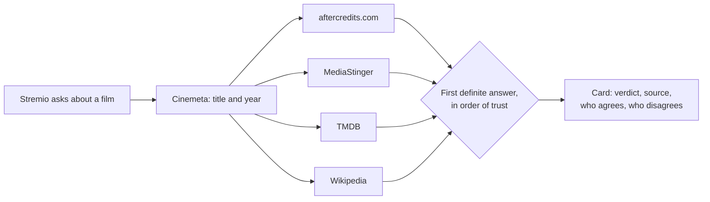

<p align="center">
  
</p>

<h1 align="center">AfterCredits for Stremio</h1>

<p align="center">
  Find out whether a film has a scene during or after the credits before you press play.
</p>

<p align="center">
  <a href="https://github.com/alexalbella/stremio-aftercredits/actions/workflows/ci.yml"></a>
  <a href="https://stremio-aftercredits.alexalbella.workers.dev"></a>
  
  
</p>

<p align="center">
  
</p>

## Install

1. Open <https://stremio-aftercredits.alexalbella.workers.dev>.
2. Pick English or Spanish, and decide whether you want to see a card when a film has nothing after the credits.
3. Press **Install in Stremio**. Use **Stremio Web** if you watch in the browser, or **Copy link** to paste the URL into *Addons → Add addon*.

It is free and needs no account or API key.

## What you see

Open any film and the addon adds one entry to the stream list, in the same style as the Ratings addon: a coloured dot, the verdict, then one short line per fact.

```
🟢 Stay · 2 scenes                       ⚪ You can go
🎬 Midway through the credits            Nothing during or after the credits
🎬 At the very end                       ✓ aftercredits • MediaStinger
👍 7 of 7 say it's worth the wait
✓ aftercredits • MediaStinger • Wikipedia
```

| Dot | Meaning |
|---|---|
| 🟢 | Stay: there is a scene during or after the credits |
| ⚪ | You can go: the sources say there is nothing |
| 🟡 | The verdict is disputed: the sources after ✗ say the opposite |
| (no card) | No source has an entry for the film |

The last line lists the sources that back the verdict (✓) and any that contradict it (✗). Selecting the card opens the page of the first one. The card never describes the scenes themselves. You can hide the "You can go" card in the settings.

## How it decides



The addon asks all four sources at the same time, giving each one six seconds to reply. Then it trusts them in this order:

| | Source | Says yes | Says no | Notes |
|---|---|:---:|:---:|---|
| 1 | [aftercredits.com](https://aftercredits.com) | ✓ | ✓ | Answers *during* and *after* separately, and readers vote on whether the scene is worth waiting for. Searched through its WordPress API, ranked by relevance, which finds older films. |
| 2 | [MediaStinger](https://mediastinger.com) | ✓ | ✓ | Gives each film a one-line verdict. |
| 3 | [TMDB](https://www.themoviedb.org) | ✓ | | Keyword tags. A missing tag proves nothing. Optional; it needs an API token. |
| 4 | [Wikipedia](https://en.wikipedia.org/wiki/List_of_films_with_post-credits_scenes) | ✓ | | The list of films with post-credits scenes. The addon reads the page source of each decade's list. |

The first source with a definite answer decides. A film only counts as a match when the title is the same and the year is at most one off, so *Thor* (2011) never picks up *Thor: Ragnarok*.

## Settings

Stremio addons carry their settings in the install URL. The configure page builds the URL for you, and Stremio's **Configure** button opens that page again.

| Install URL | Language | "You can go" card |
|---|---|---|
| `/manifest.json` | English | shown |
| `/es/manifest.json` | Spanish | shown |
| `/hidenone/manifest.json` | English | hidden |
| `/es,hidenone/manifest.json` | Spanish | hidden |

## FAQ

**Why is there no card for some films?**
None of the sources has an entry for that film. This is more common with older films and films made outside Hollywood.

**Why is a card yellow?**
The sites do not always agree. For *Barbie*, aftercredits.com lists no extras while MediaStinger and Wikipedia each list a scene, so the card turns 🟡, keeps the aftercredits.com answer and lists the other two after ✗.

**Does it work with series?**
No. Post-credits scenes are a film habit, and the sources only cover films.

**How fresh is the answer?**
- The addon checks a film the first time someone opens it, which takes two to four seconds.
- After that the answer is cached: 30 days for older films with extras, 14 days for older films without.
- Films released in the last 90 days are checked again every 12 hours, because the sites post after release.
- If any source fails, the answer is kept for only six hours. If every source fails, nothing is cached.

**What does it know about me?**
The addon only receives the IMDb id of the film you open and the settings in your install URL. It has no accounts and no tracking. Cloudflare keeps request logs for a few days.

## Run your own

The addon is a [Cloudflare Worker](https://developers.cloudflare.com/workers/) built on [Hono](https://hono.dev). It caches answers in Workers KV and fits in the free plan.

```sh
git clone https://github.com/alexalbella/stremio-aftercredits.git
cd stremio-aftercredits
pnpm install

npx wrangler kv namespace create CACHE    # put the id it prints into wrangler.jsonc
npx wrangler secret put TMDB_TOKEN        # optional: a TMDB v4 read token or v3 API key
pnpm run deploy
```

## Development

```sh
pnpm dev          # http://127.0.0.1:8787 with a local KV
pnpm test         # parsers tested against pages saved from each source
pnpm typecheck
```

To see what each source said about a film, skipping the cache, open `http://127.0.0.1:8787/api/check/tt6263850?fresh=1` (the `fresh` flag only works locally).

```
src/
  index.ts          routes: manifest, streams, configure page, debug check
  lookup.ts         asks the sources, caches the verdict
  verdict.ts        order of trust, agreement, cache lifetime
  stream.ts         the card text
  i18n.ts           English and Spanish strings
  config.ts         settings in the install URL
  text.ts           title matching
  sources/          one reader per site
static/             configure page and logo
test/               unit and route tests, with trimmed fixtures
```

The readers use regular expressions on the relevant part of each page instead of a DOM parser. A parser would cost 4 to 24 ms of CPU per page, over the free plan's 10 ms per request. Each reader is tested against real pages, so a change in a site's markup shows up as a failing test.

## Credits

This project is a fork of [megadrive/stremio-aftercredits](https://github.com/megadrive/stremio-aftercredits). The public instance of the original went offline in 2026. This fork moved it from a Node server to Cloudflare Workers, rewrote the source readers and the verdict logic, and added Spanish, settings and tests. The upstream repository has no license, so its original code remains its author's.

The answers come from [aftercredits.com](https://aftercredits.com), [MediaStinger](https://mediastinger.com), [Wikipedia](https://en.wikipedia.org) and [TMDB](https://www.themoviedb.org). Every card links back to its source. This product uses the TMDB API but is not endorsed or certified by TMDB.
